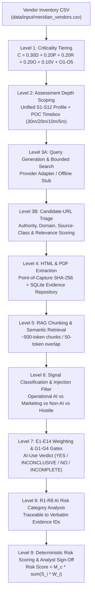
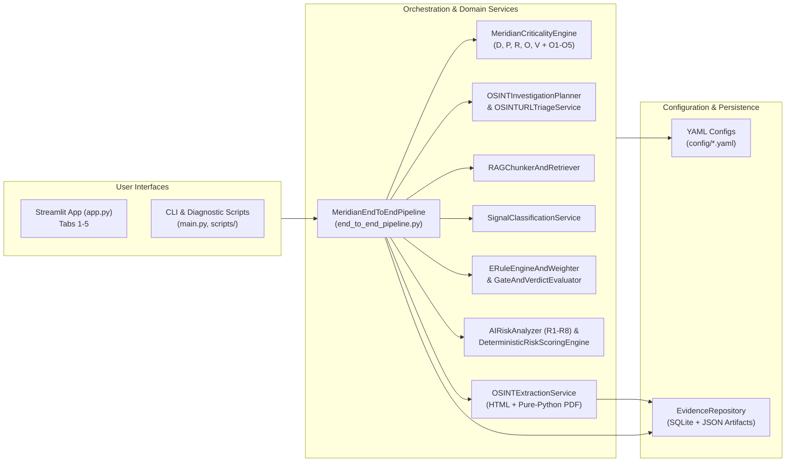

# UncoverAI — Meridian Financial Third-Party AI Risk Assessment POC

Evidence-driven, deterministic third-party vendor AI risk assessment across all nine methodology levels for Meridian Financial.

---

## 1. System Overview

UncoverAI is a proof-of-concept system built for Meridian Financial's Third-Party Risk Management (TPRM) team. It evaluates third-party vendors' public OSINT footprints across nine integrated methodology levels to determine:

1. **Vendor Criticality & Investigation Depth (Levels 1–2)**: How critical the vendor is to Meridian ($D, P, R, O, V$ formula and $O1\text{--}O5$ overrides) and how deeply its public footprint must be investigated under the unified $S1\text{--}S12$ OSINT source policy.
2. **Reconnaissance, Triage & Verbatim Extraction (Levels 3–4)**: Which authoritative public sources exist, how candidate URLs are triaged and filtered, and how HTML/PDF evidence is extracted with point-of-capture SHA-256 provenance and persisted to SQLite/JSON artifacts.
3. **Semantic Filtering & Signal Classification (Levels 5–6)**: How extracted documents are chunked (~500 tokens with 50-token overlap), filtered against prompt-injection attempts, and classified into `OPERATIONAL_AI`, `MARKETING_COMMENTARY`, `NON_AI_AUTOMATION`, or `HOSTILE_UNTRUSTED`.
4. **Evidentiary Weighting, Gates & Risk Scoring (Levels 7–9)**: How deterministic rules $E1\text{--}E14$, broad weight bands, gates $G1\text{--}G4$ (with mandatory $E1/G2$ and $E7/G4$ safeguards), AI-use verdicts (`YES`, `INCONCLUSIVE`, `NO`, `INCOMPLETE_ASSESSMENT`), risk findings $R1\text{--}R8$, and the Level 9 deterministic risk formula ($\text{Risk Score} = M_c \times \sum (S_i \times W_i)$) are computed and presented for human analyst validation.

> **Offline & Unconfigured Transparency**: UncoverAI runs completely offline by default without requiring external search API keys, running local LLMs, or pre-downloaded embedding weights. Any unconfigured external adapter or undecided production scoring parameter is explicitly surfaced with a structured status (`UNCONFIGURED_NO_CREDENTIALS`, `MODEL_UNAVAILABLE_NOT_CONFIGURED`, `SCORING_POLICY_UNCONFIGURED`) rather than silently faking results or defaulting to zero.

---

## 2. Nine Process Levels & Module Mapping

| Level | Process Stage | Primary Modules | Key Outputs |
| :--- | :--- | :--- | :--- |
| **Level 1** | **Criticality Tiering** | `src/meridian_assessment/services/meridian_criticality_engine.py`<br>`src/meridian_assessment/services/factors/` | `CriticalityResult` ($D, P, R, O, V$ scores, base score $C$, $O1\text{--}O5$ overrides, `Critical` / `High` / `Medium` / `Low`) |
| **Level 2** | **Assessment Depth Scoping** | `src/meridian_assessment/services/osint/investigation_planner.py`<br>`config/osint_source_registry.yaml` | `OSINTInvestigationPlan` ($S1\text{--}S12$ required/conditional sources, POC timeboxes `30m`/`20m`/`10m`/`5m`, stop conditions) |
| **Level 3** | **Source Identification, Reconnaissance & URL Triage** | `src/meridian_assessment/services/osint/query_planner.py`<br>`src/meridian_assessment/services/osint/search_collector.py`<br>`src/meridian_assessment/services/osint/url_triage.py` | `OSINTQueryPlan`, `CandidateURL`, `TriagedCandidateURL` (`SELECTED_FOR_EXTRACTION`, `LOW_RELEVANCE`, `REJECTED_UNSAFE`, etc.) |
| **Level 4** | **Data Scraping & Point-of-Capture Traceability** | `src/meridian_assessment/services/extraction/extractor.py`<br>`src/meridian_assessment/services/extraction/evidence_repository.py` | `ExtractedDocument`, `EvidenceRecord` (SHA-256 content hash, UTC timestamp, verbatim excerpt, SQLite + JSON artifact persistence) |
| **Level 5** | **Semantic Filtering & RAG Chunking** | `src/meridian_assessment/services/rag/chunker_retriever.py` | `EvidenceChunk` (~500 tokens, 50-token overlap), `RAGRetrievalResult` (`EmbeddingProvider` abstraction or `MODEL_UNAVAILABLE_NOT_CONFIGURED`) |
| **Level 6** | **Signal Classification & Prompt-Injection Defence** | `src/meridian_assessment/services/classification/signal_classifier.py` | `SignalClassificationResult` (`OPERATIONAL_AI`, `MARKETING_COMMENTARY`, `NON_AI_AUTOMATION`, `HOSTILE_UNTRUSTED`; stateless `OllamaClassificationAdapter`) |
| **Level 7** | **Evidentiary Weighting, Gates G1–G4 & AI-Use Verdict** | `src/meridian_assessment/services/evidence/e_rules_and_gates.py` | `WeightedEvidenceItem` ($E1\text{--}E14$, broad bands `HIGH`/`MEDIUM`/`LOW`/`NONE`), `EvaluatedGateResult` ($G1\text{--}G4$), `AIUseVerdictResult` |
| **Level 8** | **Risk Surfacing & Summarization (R1–R8)** | `src/meridian_assessment/services/risk/risk_analyzer.py` | `RiskCategoryFinding` for $R1\text{--}R8$ (`IDENTIFIED`, `POTENTIAL_UNRESOLVED`, `NOT_IDENTIFIED`, `NOT_APPLICABLE`) with verbatim evidence citations |
| **Level 9** | **Deterministic Risk Rating & Human Validation** | `src/meridian_assessment/services/risk/deterministic_scorer.py`<br>`src/meridian_assessment/services/end_to_end_pipeline.py` | `DeterministicRiskScoreResult` ($\text{Risk Score} = M_c \times \sum (S_i \times W_i)$ or `SCORING_POLICY_UNCONFIGURED`), `VendorAIRiskAssessmentReport` |

---

## 3. Functional & Technical Architecture Diagrams

### Functional Flow Across All Nine Levels



### Technical Component Architecture



---

## 4. Methodology Reference

### 4.1 Criticality Formula, Thresholds & O1–O5 Overrides (Level 1)
- **Weighted Formula**:
  $$C = 0.30D + 0.20P + 0.20R + 0.20O + 0.10V$$
- **Provisional Thresholds (`config/criticality.yaml`)**:
  - `Critical`: $C \ge 2.50$
  - `High`: $2.00 \le C \le 2.49$
  - `Medium`: $1.20 \le C \le 1.99$
  - `Low`: $0.00 \le C \le 1.19$
- **Overrides (`O1–O5`)**:
  - **O1**: Privileged credentials / administrative infrastructure access $\rightarrow$ minimum `High`.
  - **O2**: Confirmed sole-source provider (`is_sole_source=True`) + $O=3$ $\rightarrow$ `Critical`.
  - **O3**: $D=3$ and $V=3$ $\rightarrow$ minimum `High`.
  - **O4**: $P=3$ and $O \ge 2$ $\rightarrow$ minimum `High`.
  - **O5**: Auditable human analyst review (`KEEP_PROPOSED` or `CHANGE_CRITICALITY` with mandatory analyst name and rationale).

### 4.2 OSINT S1–S12 Taxonomy & POC Timeboxes (Level 2)
- **S1** (Grade A): Trust centers, subprocessor registers, DPAs, AI policies.
- **S2** (Grade A): Product documentation, API references, admin guides, release notes, SDKs, public repositories.
- **S3** (Grade A/B): Terms, privacy policies, security whitepapers.
- **S4** (Grade B): Engineering blogs, technical talks, open-source publications, model cards.
- **S5** (Grade A): Filings, annual reports, certifications, formal disclosures.
- **S6** (Grade B): Technical job postings and hiring signals.
- **S7** (Grade B/C): Executive statements and investor relations.
- **S8** (Grade B): Marketplace and partner listings.
- **S9** (Grade B): Passive technical fingerprints.
- **S10** (Grade B): Patents and research papers.
- **S11** (Grade B/C): Third-party reporting and news.
- **S12** (Grade C): Marketing pages and press releases without substantive technical detail.
- **POC Active-Effort Timeboxes**: `Critical` = 30 min (`S1–S12` required), `High` = 20 min (`S1–S8` required, `S9–S12` conditional), `Medium` = 10 min (`S1–S3, S6, S8, S12` required), `Low` = 5 min (`S1–S3, S12` required).

### 4.3 Evidence Record Schema (Level 4)
Every captured artifact creates an immutable `EvidenceRecord` containing `evidence_id`, `vendor_id`, `source_id`, `source_class` (`S1–S12`), `source_type`, `source_reliability_grade` (`A`/`B`/`C`), `source_url`, `document_title`, `publication_or_Change_date`, `retrieved_at` (UTC), `content_hash` (SHA-256), `raw_artifact_ref`, `verbatim_excerpt`, `scope` (`MERIDIAN_SERVICE`, `VENDOR_FIRM_WIDE`, `OTHER_PRODUCT`, `AMBIGUOUS`), `ai_type`, `evidence_strength`, `e_rule_ids`, `gate_mappings`, `risk_tags`, and `analyst_notes`.

### 4.4 Deterministic Evidentiary Rules E1–E14 & Broad Weight Bands (Level 7)
- **E1**: Subprocessor/DPA naming AI provider (`CONFIRMED` for G1; requires `MERIDIAN_SERVICE` scope for G2).
- **E2**: Technical docs/API/SDK showing operational AI (`CONFIRMED`).
- **E3**: Privacy/terms stating customer data trains models (`CONFIRMED` for G3/R1).
- **E4**: Privacy/terms prohibiting model training (`STRONG` mitigating signal, not zero risk).
- **E5**: Engineering blog/talk describing production ML (`STRONG`).
- **E6**: AI/ML job postings alone (`INDICATIVE`).
- **E7**: Partnership announcement without technical integration (`MARKETING` / `INDICATIVE`; cannot resolve G4 alone).
- **E8**: Generic "AI-powered" marketing claims (`MARKETING`).
- **E9**: Two or more independent non-marketing sources (`STRONG`).
- **E10**: Source conflict resolution favoring fresher, more specific Grade A/B disclosures.
- **E11**: Unscorable/unavailable source handling without fabricating negative evidence.
- **E12**: Out-of-scope product isolation (`OTHER_PRODUCT` cannot resolve G2).
- **E13**: Classical rules/batch scheduling/cron/ETL (`NON_AI` — does not trigger AI gates).
- **E14**: Hostile/prompt-injected text (`DISCARDED_HOSTILE`).
- **Broad Weight Bands**: `HIGH` ($0.80\text{--}1.00$), `MEDIUM` ($0.50\text{--}0.70$), `LOW` ($0.10\text{--}0.40$), `NONE` ($0.0$). Exact production scalar weights remain `"UNCONFIGURED"` in `config/ai_risk_scoring.yaml` until team calibration.

### 4.5 Gates G1–G4 & AI-Use Verdict Matrix (Level 7)
- **G1**: Is AI genuinely used by the vendor?
- **G2**: Is AI used inside the specific service Meridian purchases? (*Mandatory E1/G2 safeguard*: general vendor-wide AI evidence cannot resolve G2).
- **G3**: Can Meridian/customer/financial/proprietary data touch the AI path?
- **G4**: Which AI model, provider, subprocessor, or hosting infrastructure is involved? (*Mandatory E7/G4 safeguard*: partnership announcements alone cannot resolve G4).
- **Verdict Outcomes**:
  - `YES`: G1 and G2 resolved with qualifying positive evidence.
  - `INCONCLUSIVE`: Operational/indicative AI signals exist or G2 remains unresolved after investigation.
  - `NO`: Required OSINT depth is genuinely completed and only non-AI automation or marketing claims were found.
  - `INCOMPLETE_ASSESSMENT`: Required OSINT depth was not completed (e.g., unconfigured search backend or timebox exhausted before required sources were reviewed).

### 4.6 R1–R8 AI Risk Categories (Level 8)
- **R1**: Data Privacy & Confidentiality
- **R2**: Model Transparency & Explainability
- **R3**: Bias, Fairness & Adverse Customer Impact
- **R4**: Data Retention, Training Reuse & Cross-Tenant Leakage
- **R5**: Security, Prompt Injection & Adversarial Manipulation
- **R6**: Operational Resilience, Third-Party Model Dependency & Concentration Risk
- **R7**: Regulatory, Auditability & Governance Compliance
- **R8**: Unauthorized / Undisclosed Shadow AI Change Risk

### 4.7 Deterministic Risk Rating Formula & Unconfigured Parameters (Level 9)
$$\text{Risk Score} = M_c \times \sum_{i} (S_i \times W_i)$$
- Deduplicates multiple evidence records referencing the same underlying risk category ($R1\text{--}R8$) and sub-claim by retaining the strongest corroborated weight $W_i$.
- Production parameters (`criticality_multipliers`, `risk_category_severities`, `scalar_evidence_weights`, `rating_thresholds`) are explicitly set to `"UNCONFIGURED"` in `config/ai_risk_scoring.yaml` and return `SCORING_POLICY_UNCONFIGURED` (`final_risk_score = None`) until calibrated.
- An isolated test-only fixture (`tests/fixtures/test_only_ai_risk_scoring_policy.yaml`) verifies full end-to-end mathematical execution in automated tests and clearly labelled synthetic demo runs.

---

## 5. External Integration Adapter Status

| Integration | Env Vars (`.env.example`) | Default Offline Behavior |
| :--- | :--- | :--- |
| **OSINT Search Provider** | `MERIDIAN_OSINT_SEARCH_PROVIDER`, `MERIDIAN_OSINT_SERPER_API_KEY`, `MERIDIAN_OSINT_BRAVE_API_KEY`, `MERIDIAN_OSINT_GOOGLE_API_KEY`, `MERIDIAN_OSINT_GOOGLE_CX`, `MERIDIAN_OSINT_SEARXNG_URL` | Marks queries `UNAVAILABLE` (`UNCONFIGURED_NO_CREDENTIALS`) without faking search execution |
| **RAG Embeddings** | `MERIDIAN_ENABLE_RAG_EMBEDDINGS=true` | Chunks deterministically and reports `MODEL_UNAVAILABLE_NOT_CONFIGURED` |
| **Ollama Signal Classifier** | `MERIDIAN_OLLAMA_ENDPOINT`, `MERIDIAN_OLLAMA_MODEL` | Runs deterministic rulebook classifier and reports `OllamaClassificationAdapter: MODEL_UNAVAILABLE_NOT_CONFIGURED` |
| **SQLite Evidence Repository** | `MERIDIAN_EVIDENCE_DB_PATH` | Persists locally to `data/output/evidence_repository.sqlite3` and `data/output/extracted_artifacts/` |
| **Level 9 Scoring Policy** | `MERIDIAN_AI_RISK_POLICY_PATH` | Uses `config/ai_risk_scoring.yaml` (`SCORING_POLICY_UNCONFIGURED`) |

---

## 6. How to Run the Application & Tests

### Install Dependencies
```bash
python -m venv .venv
.venv\Scripts\Activate.ps1
pip install -r requirements.txt
```

### Launch the Streamlit UI (All 9 Levels)
```bash
.venv\Scripts\streamlit.exe run app.py
```
- **Tab 1 (`Vendor Workspace`)**: Level 1 D/P/R/O/V breakdown, O1–O5 overrides, O5 analyst sign-off, and Level 2 OSINT Investigation Planner & Search Collector.
- **Tab 2 (`Factor Explorer`)**: Cross-vendor D/P/R/O/V comparison.
- **Tab 3 (`Override Audit`)**: O1–O5 trigger audit across all 6 Meridian vendors.
- **Tab 4 (`Reports & Analytics`)**: Portfolio distribution and exported JSON reports.
- **Tab 5 (`🔬 End-to-End AI Risk Pipeline (Levels 1–9)`)**: Full 9-level execution in either **Default Offline/Unconfigured Mode** or **Offline Demo with Synthetic Test Fixtures**, complete with URL triage, point-of-capture SHA-256 evidence table, E1–E14 rules, G1–G4 gates, AI-Use Verdict, R1–R8 risk findings, Level 9 deterministic scoring, and human analyst sign-off.

### Run the Test Suite
```bash
.venv\Scripts\pytest.exe -v
```

### Detailed Architecture & Stakeholder Presentation Guide
See [`docs/ARCHITECTURE_AND_PRESENTATION_GUIDE.md`](docs/ARCHITECTURE_AND_PRESENTATION_GUIDE.md) for the complete 10–15 minute stakeholder presentation deck outline and the 6-vendor criticality & AI risk summary tables.