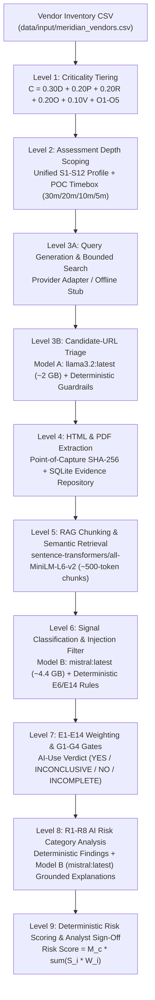
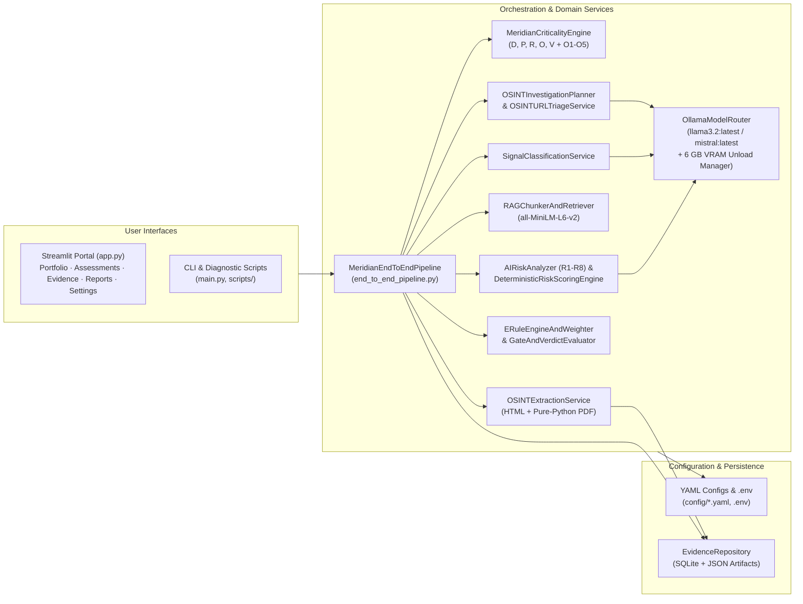

# UncoverAI — Meridian Financial Third-Party AI Risk Assessment POC

Evidence-driven, deterministic third-party vendor AI risk assessment across all nine methodology levels for Meridian Financial.

---

## 1. System Overview

UncoverAI is a proof-of-concept system built for Meridian Financial's Third-Party Risk Management (TPRM) team. It evaluates third-party vendors' public OSINT footprints across nine integrated methodology levels to determine:

1. **Vendor Criticality & Investigation Depth (Levels 1–2)**: How critical the vendor is to Meridian ($D, P, R, O, V$ formula and $O1\text{--}O5$ overrides) and how deeply its public footprint must be investigated under the unified $S1\text{--}S12$ OSINT source policy.
2. **Reconnaissance, Triage & Verbatim Extraction (Levels 3–4)**: Which authoritative public sources exist, how candidate URLs are triaged and filtered, and how HTML/PDF evidence is extracted with point-of-capture SHA-256 provenance and persisted to SQLite/JSON artifacts.
3. **Semantic Filtering & Signal Classification (Levels 5–6)**: How extracted documents are chunked (~500 tokens with 50-token overlap), filtered against prompt-injection attempts, and classified into `OPERATIONAL_AI`, `MARKETING_COMMENTARY`, `NON_AI_AUTOMATION`, `NO_AI_SIGNAL`, or `HOSTILE_UNTRUSTED`.
4. **Evidentiary Weighting, Gates & Risk Scoring (Levels 7–9)**: How deterministic rules $E1\text{--}E14$, broad weight bands, gates $G1\text{--}G4$ (with mandatory $E1/G2$ and $E7/G4$ safeguards), AI-use verdicts (`YES`, `INCONCLUSIVE`, `NO`, `INCOMPLETE_ASSESSMENT`), risk findings $R1\text{--}R8$, and the Level 9 deterministic risk formula ($\text{Risk Score} = M_c \times \sum (S_i \times W_i)$) are computed and presented for human analyst validation.

> **Offline & Unconfigured Transparency**: UncoverAI runs completely offline by default without requiring external search API keys, running local LLMs, or pre-downloaded embedding weights. Any unconfigured external adapter or undecided production scoring parameter is explicitly surfaced with a structured status (`UNAVAILABLE`, `MODEL_UNAVAILABLE_NOT_CONFIGURED`, `SCORING_POLICY_UNCONFIGURED`) rather than silently faking results or defaulting to zero.

---

## 2. Nine Process Levels & Module Mapping

| Level | Process Stage | Primary Modules | Key Outputs |
| :--- | :--- | :--- | :--- |
| **Level 1** | **Criticality Tiering** | `src/meridian_assessment/services/meridian_criticality_engine.py`<br>`src/meridian_assessment/services/factors/` | `CriticalityResult` ($D, P, R, O, V$ scores, base score $C$, $O1\text{--}O5$ overrides, `Critical` / `High` / `Medium` / `Low`) |
| **Level 2** | **Assessment Depth Scoping** | `src/meridian_assessment/services/osint/investigation_planner.py`<br>`config/osint_depth_profiles.yaml` | `OSINTInvestigationPlan` ($S1\text{--}S12$ required/conditional/corroborative sources, POC timeboxes `30m`/`20m`/`10m`/`5m`, stop conditions) |
| **Level 3** | **Source Identification, Reconnaissance & URL Triage** | `src/meridian_assessment/services/osint/query_planner.py`<br>`src/meridian_assessment/services/osint/search_collector.py`<br>`src/meridian_assessment/services/osint/url_triage.py`<br>`src/meridian_assessment/services/llm/model_router.py` | `PlannedQuery`, `CandidateURL`, `URLTriageDecision` (`FETCH`, `DEFER`, `REJECT`, `MANUAL_REVIEW` via `OllamaURLTriageProvider` routed to **`llama3.2:latest`** or `DETERMINISTIC_HEURISTIC` fallback) |
| **Level 4** | **Data Scraping & Point-of-Capture Traceability** | `src/meridian_assessment/services/extraction/extractor.py`<br>`src/meridian_assessment/services/extraction/evidence_repository.py` | `ExtractedDocument`, `EvidenceRecord` (SHA-256 content hash, UTC timestamp, verbatim excerpt, SQLite + JSON artifact persistence) |
| **Level 5** | **Semantic Filtering & RAG Chunking** | `src/meridian_assessment/services/rag/chunker_retriever.py` | `EvidenceChunk` (~500 tokens, 50-token overlap), `RAGRetrievalSummary` (separate `sentence-transformers/all-MiniLM-L6-v2` `EmbeddingProvider` — never routed to Ollama) |
| **Level 6** | **Signal Classification & Prompt-Injection Defence** | `src/meridian_assessment/services/classification/signal_classifier.py`<br>`src/meridian_assessment/services/llm/model_router.py` | `SignalClassificationResult` (`OPERATIONAL_AI`, `MARKETING_COMMENTARY`, `NON_AI_AUTOMATION`, `NO_AI_SIGNAL`, `HOSTILE_UNTRUSTED` via `OllamaClassificationAdapter` routed to **`mistral:latest`** with deterministic rule safeguards) |
| **Level 7** | **Evidentiary Weighting, Gates G1–G4 & AI-Use Verdict** | `src/meridian_assessment/services/evidence/e_rules_and_gates.py` | `WeightedEvidenceItem` ($E1\text{--}E14$, broad bands `HIGH`/`MEDIUM`/`LOW`/`NONE`), `EvaluatedGateResult` ($G1\text{--}G4$), `AIUseVerdictResult` |
| **Level 8** | **Risk Surfacing & Summarization (R1–R8)** | `src/meridian_assessment/services/risk/risk_analyzer.py`<br>`src/meridian_assessment/services/llm/model_router.py` | `AIRiskFinding` for $R1\text{--}R8$ (`CONFIRMED_EXPOSURE`, `INDICATED_BY_EVIDENCE`, `CONTROL_NOT_PUBLICLY_EVIDENCED`, `MITIGATED_BY_EVIDENCE`, `UNKNOWN_UNRESOLVED`) with verbatim evidence citations and evidence-grounded `analyst_explanation` drafted via `OllamaRiskSummaryAdapter` (**`mistral:latest`**) |
| **Level 9** | **Deterministic Risk Rating & Human Validation** | `src/meridian_assessment/services/risk/deterministic_scorer.py`<br>`src/meridian_assessment/services/end_to_end_pipeline.py` | `DeterministicRiskScoreResult` ($\text{Risk Score} = M_c \times \sum (S_i \times W_i)$ or `SCORING_POLICY_UNCONFIGURED`), `VendorEndToEndAssessmentReport` |

---

## 3. Functional & Technical Architecture Diagrams

### Functional Flow Across All Nine Levels



### Technical Component Architecture



---

## 4. Methodology Reference

### 4.1 Criticality Formula, Thresholds & O1–O5 Overrides (Level 1)
- **Weighted Formula**:
  $$C = 0.30D + 0.20P + 0.20R + 0.20O + 0.10V$$
- **Provisional Thresholds (`config/criticality.yaml`)**:
  - `Critical`: $C \ge 2.50$
  - `High`: $2.00 \le C \le 2.49$
  - `Medium`: $1.20 \le C \le 1.99$
  - `Low`: $0.00 \le C \le 1.19$
- **Overrides (`O1–O5`)**:
  - **O1**: Privileged credentials / administrative infrastructure access $\rightarrow$ minimum `High`.
  - **O2**: Confirmed sole-source provider (`is_sole_source=True`) + $O=3$ $\rightarrow$ `Critical`.
  - **O3**: $D=3$ and $V=3$ $\rightarrow$ minimum `High`.
  - **O4**: $P=3$ and $O \ge 2$ $\rightarrow$ minimum `High`.
  - **O5**: Auditable human analyst review (`KEEP_PROPOSED` or `CHANGE_CRITICALITY` with mandatory analyst name and rationale).

### 4.2 OSINT S1–S12 Taxonomy, Depth Profiles & POC Timeboxes (Level 2)
- **Canonical S1–S12 Source Classes (`config/osint_source_registry.yaml`)**:
  - **S1** (Grade A): Trust centers, subprocessor registers, DPAs, and AI policies.
  - **S2** (Grade A): Product documentation, API references, admin guides, release notes, SDKs, and public repositories.
  - **S3** (Grade A/B): Terms, privacy policies, and security whitepapers.
  - **S4** (Grade A/B): Engineering blogs, technical talks, open-source technical publications, and model cards.
  - **S5** (Grade B): Filings, annual reports, certifications, and formal disclosures.
  - **S6** (Grade B): Technical job postings and hiring signals.
  - **S7** (Grade B): Executive statements and investor relations.
  - **S8** (Grade B/C): Marketplace and partner listings.
  - **S9** (Grade C, Corroborative): Passive technical fingerprints.
  - **S10** (Grade C, Corroborative): Patents and research papers.
  - **S11** (Grade C, Corroborative): Third-party reporting and news.
  - **S12** (Grade D): Marketing pages and press releases without substantive technical detail.
- **Unified Depth Profiles & POC Active-Effort Timeboxes (`config/osint_depth_profiles.yaml`)**:
  - **Critical** (**30 min**): Required `S1–S12` | Conditional: None | Corroborative: `S9, S10, S11`.
  - **High** (**20 min**): Required `S1, S2, S3, S5, S6, S7, S8` | Conditional: `S4` (engineering blogs/talks/model cards), `S9` (passive technical fingerprints), `S11` (third-party reporting/news) | Corroborative: `S10, S12`.
  - **Medium** (**10 min**): Required `S1, S2, S3, S6` | Conditional: `S4, S9` | Corroborative: `S12`.
  - **Low** (**5 min**): Required `S1, S3, S12` | Conditional: `S2` | Corroborative: None.

### 4.3 Evidence Record Schema (Level 4)
Every captured artifact creates an `EvidenceRecord` containing `evidence_id`, `document_id`, `vendor_id`, `legal_entity`, `domain`, `source_class` (`S1–S12`), `source_reliability_grade` (`A`/`B`/`C`/`D`), `source_reliability_rating` (`1–5`), `canonical_url`, `original_url`, `published_or_observed_date`, `retrieved_at` (UTC), `content_sha256` (SHA-256), `raw_artifact_path`, `verbatim_excerpt`, `scope` (`MERIDIAN_SERVICE`, `VENDOR_PRODUCT`, `VENDOR_FIRM_WIDE`, `UNRESOLVED`), `ai_type`, `evidence_strength`, `e_rule_ids`, `risk_tags`, `no_training_commitment`, `zdr_commitment`, `is_opt_in_only`, and `hostile_instruction_detected`.

### 4.4 Deterministic Evidentiary Rules E1–E14 & Broad Weight Bands (Level 7)
Implemented in [`src/meridian_assessment/services/evidence/e_rules_and_gates.py`](src/meridian_assessment/services/evidence/e_rules_and_gates.py):
- **E1**: Named AI model, provider, or API endpoint in authoritative disclosure (`S1–S5, S8`) — `CONFIRMED` in `MERIDIAN_SERVICE` scope (`S1–S3, S5`); records provider/model for `G1/G4` without auto-confirming `G2` when scope is broader (`E1/G2` safeguard).
- **E2**: Specific AI functionality (inputs, outputs, inference workflow, or settings) — `CONFIRMED` in `MERIDIAN_SERVICE` scope (`S1–S5`), `INDICATIVE` if product/Meridian scope is unclear.
- **E3**: Technical hiring / job postings (`S6`) — `STRONG` when naming a production AI stack/provider tied to the product; `INDICATIVE` for generic or research AI roles.
- **E4**: Executive or Investor Relations statements (`S7`) — `STRONG` when naming a specific product, workflow, or production scale; `MARKETING` when vague/promotional.
- **E5**: Marketing-only claims (`S12` or unsubstantiated promotional buzzwords without technical mechanism) — `MARKETING` ($W_i = 0$).
- **E6**: Automation distinction — ordinary workflow automation, batch scheduling, cron jobs, rules engines, or RPA without ML/LLM evidence is classified as non-AI (`AIType.NONE_AUTOMATION_ONLY`, `EvidenceStrength.NONE`, $W_i = 0$).
- **E7**: Partnership announcement without concrete technical integration details — capped at `INDICATIVE` and cannot resolve Gate `G4` alone (`E7/G4` safeguard).
- **E8**: Patent applications or exploratory R&D research papers (`S10`) — `INDICATIVE` only (capability, not proof of production deployment).
- **E9**: Independent corroboration across $\ge 2$ distinct source classes with non-duplicate text — upgrades `INDICATIVE` operational AI claims to `STRONG`.
- **E10**: Historical ($>24$ months old) or removed/archived evidence — downgraded by one strength level (`CONFIRMED` $\rightarrow$ `STRONG`, `STRONG` $\rightarrow$ `INDICATIVE`, etc.).
- **E11**: Third-party reporting and news (`S11`) — `STRONG` if quoting a verifiable primary vendor disclosure; `INDICATIVE` otherwise.
- **E12**: Opt-in or disabled-by-default AI features — records activation caveats (`is_opt_in_only = True`) so feature availability is not conflated with active deployment for Meridian.
- **E13**: No-training and Zero-Data-Retention (ZDR) assertions — `STRONG` when stated in contract-grade sources (`S1`, `S3`, `S5`); `INDICATIVE` when stated in non-contractual or marketing sources.
- **E14**: Hostile webpage/PDF prompt-injection instructions — isolated and discarded (`DISCARDED_HOSTILE`, $W_i = 0$).
- **Broad Weight Bands**: `HIGH` ($0.80\text{--}1.00$), `MEDIUM` ($0.50\text{--}0.70$), `LOW` ($0.10\text{--}0.40$), `NONE` ($0.0$). Exact production scalar weights remain `"UNCONFIGURED"` in `config/ai_risk_scoring.yaml` until team calibration.

### 4.5 Gates G1–G4 & AI-Use Verdict Matrix (Level 7)
- **G1**: Is AI genuinely used by the vendor?
- **G2**: Is AI used inside the specific service Meridian purchases? (*Mandatory E1/G2 safeguard*: general vendor-wide or other-product AI evidence cannot resolve G2).
- **G3**: Can Meridian/customer/financial/proprietary data touch the AI path?
- **G4**: Which AI model, provider, subprocessor, or hosting infrastructure is involved? (*Mandatory E7/G4 safeguard*: partnership announcements alone cannot resolve G4).
- **Verdict Outcomes**:
  - `YES`: G1 and G2 resolved with qualifying positive evidence.
  - `INCONCLUSIVE`: Operational/indicative AI signals exist or G2 remains unresolved after investigation.
  - `NO`: Required OSINT depth is genuinely completed and only non-AI automation (`E6`) or marketing claims (`E5`) were found.
  - `INCOMPLETE_ASSESSMENT`: Required OSINT depth was not completed (e.g., unconfigured search backend or timebox exhausted before required sources were reviewed).

### 4.6 R1–R8 AI Risk Categories (Level 8)
Implemented in [`src/meridian_assessment/services/risk/risk_analyzer.py`](src/meridian_assessment/services/risk/risk_analyzer.py):
- **R1**: Customer Data Used for Model Training or Fine-Tuning
- **R2**: Third-Party AI Provider & Subprocessor Exposure
- **R3**: AI Prompt, Output & Log Data Retention
- **R4**: Sensitive & Regulated Data Exposure in AI Path
- **R5**: AI Transparency, Inventory & Governance Gaps
- **R6**: Autonomous AI Execution & Material Decision-Making
- **R7**: AI Infrastructure, Residency & Supply-Chain Dependency
- **R8**: AI Attack Surface, Prompt Injection & Multi-Tenant Isolation

### 4.7 Deterministic Risk Rating Formula & Unconfigured Parameters (Level 9)
$$\text{Risk Score} = M_c \times \sum_{i} (S_i \times W_i)$$
- Deduplicates multiple findings referencing the same underlying exposure key by retaining the strongest corroborated finding.
- Production parameters (`criticality_multipliers`, `exposure_severity_mapping`, `exact_scalar_weights`, `rating_thresholds`) are explicitly set to `"UNCONFIGURED"` in `config/ai_risk_scoring.yaml` and return `SCORING_POLICY_UNCONFIGURED` (`final_risk_score = None`) until calibrated.
- An isolated test-only fixture (`tests/fixtures/test_only_ai_risk_scoring_policy.yaml`) verifies full end-to-end mathematical execution in automated tests.

---

## 5. Dual-Model Local Ollama Routing & 6 GB VRAM Management

Implemented in [`src/meridian_assessment/services/llm/model_router.py`](src/meridian_assessment/services/llm/model_router.py) (`OllamaModelRouter`, `ModelRoutingConfig`, `LLMTaskType`, `LLMExecutionStatus`):

| Model Tier | Assigned Model | Pipeline Stage & Service | Responsibility & Guardrails |
| :--- | :--- | :--- | :--- |
| **Model A (Lightweight)** | **`llama3.2:3b` / `llama3.2:latest`** (~2.0 GB) | **Level 3B**: `OSINTURLTriageService` $\rightarrow$ `OllamaURLTriageProvider` (`LLMTaskType.URL_TRIAGE`) | Categorizes candidate URLs by relevance (`FETCH`, `DEFER`, `REJECT`, `MANUAL_REVIEW`), canonical source class (`S1–S12`), and target gates (`G1–G4`). Pre-screens snippets for prompt injection before LLM invocation and validates output against strict enums. |
| **Model B (Deep Analysis)** | **`mistral:latest` / `qwen2.5:3b`** (~2.0–4.4 GB) | **Level 6**: `SignalClassificationService` $\rightarrow$ `OllamaClassificationAdapter` (`LLMTaskType.EVIDENCE_CLASSIFICATION`) | Performs deeper semantic signal classification on extracted evidence excerpts after deterministic `E14` prompt-injection isolation. Cannot override deterministic `E1–E14` rules or `G1–G4` gates. |
| **Model B (Grounded Summary)** | **`mistral:latest` / `qwen2.5:3b`** (~2.0–4.4 GB) | **Level 8**: `AIRiskAnalyzer` $\rightarrow$ `OllamaRiskSummaryAdapter` (`LLMTaskType.RISK_SUMMARIZATION`) | Drafts analyst-facing explanations (`AIRiskFinding.analyst_explanation`) grounded strictly in verbatim `EvidenceRecord` excerpts. Rejects any summary that fails to cite valid `supporting_evidence_ids` or introduces ungrounded claims. Never alters deterministic `FindingSeverity` or `ExposureDetermination`. |
| **Separate Embedding Path** | **`sentence-transformers/all-MiniLM-L6-v2`** | **Level 5**: `RAGChunkerAndRetriever` (`LLMTaskType.RAG_EMBEDDING`) | Runs via the dedicated `EmbeddingProvider` interface. `OllamaModelRouter` explicitly raises `ValueError` if any code attempts to route `RAG_EMBEDDING` to a generative Ollama model. |

### 6 GB VRAM Switching & Unloading Strategy
When operating within a standard 6 GB VRAM budget with larger model configurations (e.g., `llama3.2:latest` at ~2.0 GB and `mistral:latest` at ~4.4 GB totaling ~6.4 GB), holding both models simultaneously would risk VRAM exhaustion or CPU offload thrashing:
1. **Batched Stage Execution**: All Level 3B candidate URLs for a vendor are triaged together on Model A before extraction and deeper analysis begin.
2. **Explicit Stage-Boundary & Switch Unloading**: When `MERIDIAN_OLLAMA_UNLOAD_ON_SWITCH=true` (default), `OSINTURLTriageService.triage_plan_candidates()` and `OllamaModelRouter.generate_json()` send an explicit `POST /api/generate` with `"keep_alive": 0` to unload Model A from VRAM before loading Model B for Level 6 and Level 8, and unload Model B upon stage completion. Every unload event is recorded in `report.model_routing_telemetry["vram_management"]["vram_unload_events"]`.

---

## 6. External Integration & Environment Configuration (`.env` / `.env.example`)

UncoverAI automatically loads a root `.env` file via [`src/meridian_assessment/config/env_loader.py`](src/meridian_assessment/config/env_loader.py) without overwriting explicitly exported shell environment variables. Real `.env` files are ignored by `.gitignore`.

| Integration | Environment Variables | Default in `.env` | Notes & Fallback Behavior |
| :--- | :--- | :--- | :--- |
| **OSINT Search & Web Scraping** | `MERIDIAN_SEARCH_PROVIDER`<br>`MERIDIAN_SERPER_API_KEY`<br>`MERIDIAN_SCRAPERAPI_KEY`<br>`MERIDIAN_GOOGLE_API_KEY`<br>`MERIDIAN_GOOGLE_CSE_ID`<br>`MERIDIAN_BRAVE_API_KEY`<br>`MERIDIAN_BING_API_KEY`<br>`MERIDIAN_SERPAPI_KEY` | `MERIDIAN_SEARCH_PROVIDER=serper`<br>API keys left blank (`""`) | `serper` is the primary search backend. ScraperAPI (`MERIDIAN_SCRAPERAPI_KEY`) is automatically used as a resilient fallback for anti-bot blocked webpages. Secondary search adapters (`google_cse`, `brave`, `bing`, `serpapi`) are fully supported. When API keys are blank, `build_search_backend_from_env()` returns `UnconfiguredSearchBackend` with an explicit status message and marks planned queries `UNAVAILABLE` without faking search execution. |
| **Dual-Model Local Ollama** | `MERIDIAN_OLLAMA_ENABLED`<br>`MERIDIAN_OLLAMA_ENDPOINT`<br>`MERIDIAN_OLLAMA_TRIAGE_MODEL`<br>`MERIDIAN_OLLAMA_ANALYSIS_MODEL`<br>`MERIDIAN_OLLAMA_SUMMARY_MODEL`<br>`MERIDIAN_OLLAMA_TIMEOUT_SECONDS`<br>`MERIDIAN_OLLAMA_KEEP_ALIVE`<br>`MERIDIAN_OLLAMA_UNLOAD_ON_SWITCH` | `true` in `.env` (`false` in `.env.example`)<br>`http://localhost:11434`<br>`llama3.2:3b` (or `llama3.2:latest`)<br>`qwen2.5:3b` (or `mistral:latest`)<br>`qwen2.5:3b` (or `mistral:latest`)<br>`25.0`<br>`2m`<br>`true` | If Ollama is unreachable, a model is not installed, a request times out, or JSON output fails schema/grounding validation, the router records the exact fault status (`UNAVAILABLE`, `MODEL_NOT_INSTALLED`, `TIMEOUT`, `INVALID_OUTPUT`) and falls back transparently to deterministic rules. |
| **RAG Embeddings** | `MERIDIAN_ENABLE_RAG_EMBEDDINGS`<br>`MERIDIAN_EMBEDDING_MODEL` | `true` in `.env` (`false` in `.env.example`)<br>`sentence-transformers/all-MiniLM-L6-v2` | Chunks deterministically and reports `MODEL_UNAVAILABLE_NOT_CONFIGURED` if disabled or uninstalled. |
| **SQLite Evidence Repository** | `MERIDIAN_EVIDENCE_DB_PATH` | `data/output/evidence_store/meridian_evidence.sqlite3` | Persists locally to SQLite and `data/output/evidence_store/artifacts/`. |
| **Level 9 Scoring Policy** | `MERIDIAN_AI_RISK_POLICY_PATH` | `config/ai_risk_scoring.yaml` | Reports `SCORING_POLICY_UNCONFIGURED` (`final_risk_score = None`) until production parameters are approved. |

---

## 7. How to Start Ollama, Run the Application & Execute Tests

### 1. Verify Local Ollama Models
Ensure Ollama is running (`ollama serve`) and the configured models are installed:
```powershell
ollama list
# Expected (or your configured models in .env):
# llama3.2:3b (or llama3.2:latest)
# qwen2.5:3b  (or mistral:latest)
```

### 2. Install Python Dependencies
```powershell
python -m venv .venv
.venv\Scripts\Activate.ps1
pip install -r requirements.txt
```

### 3. Launch the Streamlit Portal
```powershell
.venv\Scripts\streamlit.exe run app.py
```
The Streamlit application provides a comprehensive TPRM governance portal across 5 workspaces:
- **Portfolio**: 5-KPI executive summary, vendor criticality tiering breakdown, and filterable vendor inventory table.
- **Assessments (Three-Stage Assessment Workspace)**:
  - **A. Assessment Setup & Scope Configuration**: Select a portfolio vendor (e.g. `V-002: Fiserv, Inc.`) or enter a custom vendor. Choose an **Execution Mode**:
    - `Live OSINT Assessment (Serper Search + Direct HTTP / ScraperAPI)`
    - `Sample Assessment (Pre-Collected Demonstration Fixtures)`
    - Configure stage-by-stage local AI routing checkboxes (`Level 3B URL Triage`, `Level 5 RAG Embeddings`, `Level 6 Signal Classification`, `Level 8 Risk Summaries`).
  - **B. Assessment Execution & Pipeline Status**: Click **Run Live OSINT Assessment** or **Run Sample Assessment**. Runs execute asynchronously via a background daemon worker thread with a persistent status pill in the header, allowing seamless navigation across tabs without freezing. Use the `🛑 Cancel / Stop Run` button to immediately halt an active run, or `Clear Status / Reset` to reset.
  - **C. Assessment Results & Analyst Governance**: Review detailed assessment outputs across 5 sub-tabs:
    1. *Executive Summary & Gates (G1–G4)*: AI-use verdict, gate determinations, and supporting evidence IDs.
    2. *Criticality Result (D/P/R/O/V)*: Base score $C$, factor breakdowns, and O1–O5 override evaluations.
    3. *Evidence Register*: Point-of-capture SHA-256 evidence records with verbatim excerpts and S1–S12 classes.
    4. *Risk Findings & Open Questions*: Surfaced R1–R8 risk findings with severity and grounded explanations.
    5. *Human Review & Exports*: Analyst sign-off, override controls, and multi-format reports.
- **Evidence**: Point-of-capture evidence workbench with multi-dimensional filtering across vendors, source classes, and verification statuses.
- **Reports**: Executive vendor assessment dossier and export center (HTML, Markdown, Evidence CSV, JSON).
- **Settings**: System readiness diagnostics for search APIs, ScraperAPI, Ollama models, and SQLite persistence.

### 4. Run the Diagnostic Script (Meridian 6-Vendor Dataset)
```powershell
.venv\Scripts\python.exe scripts/generate_diagnostic.py
```

### 5. Run the Complete Automated Test Suite
```powershell
.venv\Scripts\pytest.exe -v
```

### Detailed Architecture & Stakeholder Presentation Guide
See [`docs/ARCHITECTURE_AND_PRESENTATION_GUIDE.md`](docs/ARCHITECTURE_AND_PRESENTATION_GUIDE.md) for the complete 10–15 minute stakeholder presentation deck outline and the verified 6-vendor criticality & AI risk summary tables.